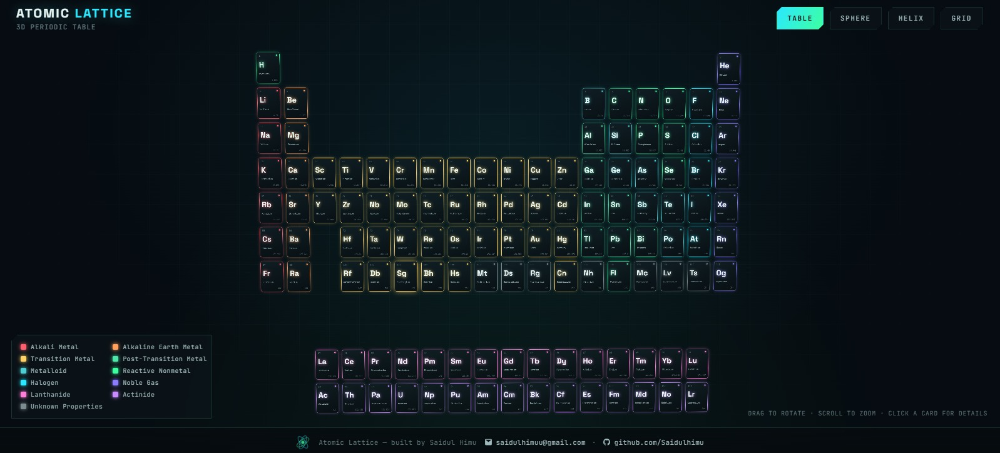

# 🧪 ATOMIC LATTICE — Interactive 3D Periodic Table

[](https://saidul-dev-mern.vercel.app)
[](https://threejs.org/)
[](https://developer.mozilla.org/en-US/docs/Web/JavaScript)
[](https://developer.mozilla.org/en-US/docs/Web/API/Web_Audio_API)
[](LICENSE)

An interactive, high-performance **3D Periodic Table of Chemical Elements** designed with a futuristic Sci-Fi / Cyberpunk Lab Console aesthetic. Powered by **Three.js (CSS3DRenderer)**, **Tween.js**, and native **Web Audio API**, this project transforms all 118 chemical elements into interactive 3D spatial cards with real-time Bohr atomic models.

---

## 📷 Preview


---

## ✨ Features & Enhancements

### 🔄 1. Four Dynamic Spatial 3D Views
- **Table Mode:** Standard 2D periodic table layout with traditional separation of Lanthanides and Actinides.
- **Sphere Mode:** Smooth Fibonacci spherical distribution where cards face radially outward.
- **Helix Mode:** Cylindrical double-helix spiral winding along a vertical axis.
- **Grid Mode:** A $5 \times 5 \times 5$ volumetric cube matrix organizing elements in 3D lattice space.
- Smooth mathematical transitions powered by **Tween.js** with exponential easing.

### 🔍 2. Real-Time Search & Visual Isolation
- Instant search by **Element Name** (e.g., *Gold*, *Carbon*), **Chemical Symbol** (e.g., *Au*, *Fe*), or **Atomic Number** (e.g., *79*).
- Matching element cards remain brightly illuminated with pulsing neon highlights, while non-matching cards smoothly dim with grayscale filters.
- Real-time matching element counter (e.g. `1 / 118`).
- Pressing <kbd>Enter</kbd> on a single match automatically opens its detailed view.

### 🎨 3. Interactive Category Filter & Legend
- Interactive legend covering all 11 chemical families:
  - *Alkali Metals*, *Alkaline Earth Metals*, *Transition Metals*, *Post-Transition Metals*, *Metalloids*, *Reactive Nonmetals*, *Halogens*, *Noble Gases*, *Lanthanides*, *Actinides*, and *Unknown Properties*.
- Click any category to isolate and highlight only those elements; click again or press **Reset** to restore all cards.

### ⚛️ 4. Dynamic Bohr Atomic Model Simulation
- Clicking any element card opens an in-depth modal featuring:
  - **Animated Bohr Model Canvas:** Real-time orbiting electrons configured to the element's actual shell structure ($K, L, M, N, O, P, Q$).
  - **State of Matter Indicator:** Color-coded badges for *Solid*, *Liquid*, *Gas*, or *Synthetic*.
  - **Full Chemical Data:** Atomic mass, group, period, orbital block ($s, p, d, f$), electron configuration (e.g. `[Ar] 3d⁶ 4s²`), and historical occurrence summary.
  - **Modal Element Carousel:** Navigate seamlessly through elements using <kbd>◀ Prev</kbd> and <kbd>Next ▶</kbd> buttons or arrow keys.

### 🔊 5. Zero-Asset Sci-Fi Synthesizer Sound FX
- Built using the native browser **Web Audio API** (requires zero external audio file downloads).
- Generates dynamic frequency sweeps for camera transitions, UI clicks, modal activations, and card selections.
- Includes a persistent sound toggle (<kbd>M</kbd>) saved to `localStorage`.

### ⚡ 6. High-FPS Rendering & Hardware Optimization
- Replaced expensive backdrop blurs across 118 simultaneous 3D-transformed DOM nodes with optimized translucent card backgrounds and CSS containment.
- Implemented `contain: layout style;`, `backface-visibility: hidden;`, and `transform: translateZ(0)` for hardware acceleration.
- Yields buttery-smooth **60–120 FPS** performance during 360° orbit rotation, zoom, and transitions even on mid-range hardware.

---

## ⌨️ Keyboard Shortcuts

| Shortcut | Action |
| :--- | :--- |
| <kbd>1</kbd> | Switch to **Table View** |
| <kbd>2</kbd> | Switch to **Sphere View** |
| <kbd>3</kbd> | Switch to **Helix View** |
| <kbd>4</kbd> | Switch to **Grid View** |
| <kbd>/</kbd> or <kbd>Ctrl</kbd> + <kbd>K</kbd> | Focus Search Bar |
| <kbd>Space</kbd> | Toggle 3D Auto-Rotation |
| <kbd>R</kbd> | Reset Camera Position & Zoom |
| <kbd>M</kbd> | Toggle Sound Effects (On / Off) |
| <kbd>Esc</kbd> | Close Modals / Clear Active Search |
| <kbd>◀</kbd> / <kbd>▶</kbd> | Navigate Previous / Next Element in Modal |

---

## 🛠️ Tech Stack

- **Core Technologies:** HTML5, CSS3 (Custom Properties, Glassmorphism, Keyframes), JavaScript (ES6+)
- **3D Graphics Engine:** [Three.js](https://threejs.org/) (r128) with `CSS3DRenderer` and `OrbitControls`
- **Animation Interpolation:** [Tween.js](https://github.com/tweenjs/tween.js/)
- **Audio Synthesis:** Native Web Audio API
- **Fonts:** Space Grotesk & JetBrains Mono (Google Fonts)

---

## 🚀 Getting Started Locally

No complex build steps or package managers required. Simply clone and run:

```bash
# Clone the repository
git clone https://github.com/Saidulhimu/Periodic-table-3d.git

# Navigate into the project folder
cd Periodic-table-3d

# Start a local HTTP server using Python:
python -m http.server 3000

# Or using Node.js:
# npx serve .
```

Open `http://localhost:3000` in your web browser to explore.

---

## 👨‍💻 Author

**Saidul Himu**
- Email: [saidulhimuu@gmail.com](mailto:saidulhimuu@gmail.com)
- GitHub: [@Saidulhimu](https://github.com/Saidulhimu)

---

## 📄 License

This project is licensed under the MIT License - feel free to use and customize it for educational and personal projects!
